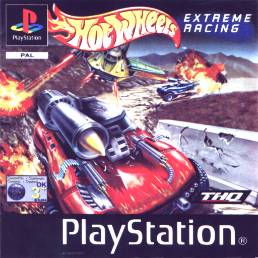

# Hot Wheels Extreme Racing

<!-- retcomm-readme-metrics -->
[](https://github.com/RetroPortingToolKit/Hot-Wheels-Extreme-Racing/releases)
[](https://github.com/RetroPortingToolKit/Hot-Wheels-Extreme-Racing/releases/latest)
[](https://github.com/RetroPortingToolKit/Hot-Wheels-Extreme-Racing/releases/latest)
<!-- /retcomm-readme-metrics -->

<!-- retcomm-readme-boxart -->
<p align="center">
  
</p>
<!-- /retcomm-readme-boxart -->

Static recompilation of **Hot Wheels Extreme Racing** built on
[psxrecomp](https://github.com/mstan/psxrecomp) and
[recomp-ui](https://github.com/RetroPortingToolKit/recomp-ui).

Racing

| | |
|---|---|
| Players | 4 |
| Region | USA |
| Publisher | — |
| Year | — |

Scaffolded with the New Project Layout. See
`psxrecomp/docs/GAME_PROJECT_SETUP.md` for the full flow.

<!-- retcomm-readme-launcher -->
## Retro Launcher

You can run this title **standalone** (download the release zip, point it at
your disc, play), or manage installs, updates, and disc/BIOS wiring with
**[Retro Launcher](https://github.com/RetroPortingToolKit/Retro-Launcher)** —
the Retro Compilation Manager hub for self-compiling recomps.

[Downloads](https://github.com/RetroPortingToolKit/Retro-Launcher/releases) ·
[Full README & features](https://github.com/RetroPortingToolKit/Retro-Launcher#readme)

<p align="center">
  
</p>

<p align="center">
  
</p>

Retro checks for updates, installs the prebuilt release zips, and automates
BIOS/ROM/save plumbing so you are not stuck repeating each game’s first run by hand.
<!-- /retcomm-readme-launcher -->

## Legal

You must own the original game. Disc images under `disc/` are gitignored and
must never be committed. Retail BIOS dumps are not redistributed and no C
derived from one may be committed; releases run on the bundled MIT OpenBIOS.

`generated/` (the recompiled game C) **is committed**: releases ship the
compiled game, built by CI from that tree. Regenerate and commit it whenever
seeds or the framework pin change.

Default app icon: `assets/psxrecomp.ico` (and `.png` / `.svg`) — Retro-themed controller mark from `psxrecomp/assets/`. Windows builds embed it via `APP_ICON`.

Optional box art under `launcher_assets/img/` may come from
[libretro-thumbnails](https://github.com/libretro-thumbnails/libretro-thumbnails)
(`Named_Boxarts`); see `BOXART_SOURCE.txt` when present.

## Quick start

```bash
git submodule update --init --recursive
./psxrecomp/tools/ci/build_emitters.sh
python3 psxrecomp/psxrecomp_cli.py generate \
  --config game.toml --project-root . --disc disc/<your>.cue
git add generated && git commit -m "Regenerate game C"
# Configures, builds, and stages overlay_toolchain/ beside the runtime so
# streamed overlays can be compiled to native shards (a bare cmake build
# skips that stage and leaves every overlay gap interpreted).
python3 psxrecomp/psxrecomp_cli.py rebuild \
  --config game.toml --project-root . --build-dir build-release --no-pgo
```

Official optimized Windows/Linux releases use the maintained shared builder
with the title disc available. Commit the desired `VERSION`, source and
framework pins, then run:

```bash
scripts/package_release.sh --channel public
# Use --channel playtest for a non-public package; --platform selects Windows/Linux.
```

On Windows PowerShell, use
`psxrecomp/tools/package_title_release.ps1 --channel public`. The generated
`packaging/release.toml` and player instructions define the title payload.
The shared builder owns regeneration, qualified build defaults, fresh private
PGO boot training on supported native toolchains, staging and verification.
Boot training is a build step, not gameplay qualification or a performance
claim. See `psxrecomp/docs/RELEASING_A_TITLE.md`.

The separate *Release builds* CI workflow (tag `vX.Y.Z` or dispatch) builds
committed `generated/` C without a disc on Linux, Windows and macOS. It uses
`scripts/package_prebuilt_release.sh` and attaches compiled-game ZIPs. That
explicit prebuilt path does not train selective PGO and is not the official
optimized-release command. The common builder does not add macOS support.

Studio's current Export action still uses the old prebuilt argument contract;
use the shared command above for optimized releases until Studio adopts the
recipe/channel interface. Its packager detection and `packaging/` warning also
need that adoption; the generated recipe is maintained configuration, not a
forked packager.

## Symbols

Progressive map: `symbols.toml` → `python3 tools/sync_symbols.py` →
`psx_symbols.h` (`PSX_FN_*`). See `psxrecomp/docs/SYMBOLS.md`.

## Framework pins

Submodule gitlinks (`psxrecomp`, optional `recomp-ui`, nested `recomp-net`)
are authoritative. `framework_pins.txt` is an optional scaffold snapshot;
release CI logs SHAs with `record_pins.sh` but builds whatever the gitlinks
resolve to. Bump submodules deliberately — do not float on `main`/`master`
in release CI.

<!-- retcomm-readme-raid -->
---

<p align="center">
  <sub><b>R.A.I.D. — Retro AI Development</b> · a Discord for AI-assisted retro reverse-engineering, decomp &amp; recomp</sub>
</p>

<p align="center">
  <a href="https://discord.gg/Ad9BwSzctP"></a>
</p>
<!-- /retcomm-readme-raid -->

# Hot Wheels: Extreme Racing (PSXRecomp Port)

Recompilación estática nativa para PC de **Hot Wheels: Extreme Racing (Europe)** mediante [PSXRecomp](https://github.com).

> **Aviso Legal:** Este repositorio no contiene archivos con derechos de copyright (imagen del juego ni BIOS de PlayStation). Debes aportar tus propias copias legales.

---

## 📁 Estructura de archivos requerida

Coloca tu BIOS (`SCPH1001.BIN`) y la imagen de tu disco (.cue/.bin) en las carpetas correspondientes antes de compilar:

```text
Hot-Wheels-Extreme-Racing/
├── bios/SCPH1001.BIN
├── disc/Hot Wheels - Extreme Racing (Europe).cue (.bin)
├── psxrecomp/
├── game.toml
└── symbols.toml
```

---

## 🛠️ 1. Instalación de dependencias

Instala CMake, Ninja, Python 3, ccache y las librerías de desarrollo para gráficos, audio y controles (SDL3):

* **Void Linux:** `sudo xbps-install -Sy base-devel cmake ninja python3 git ccache pkg-config alsa-lib-devel pulseaudio-devel pipewire-devel libX11-devel wayland-devel MesaLib-devel vulkan-loader`
* **Arch Linux:** `sudo pacman -S --needed base-devel cmake ninja python git ccache pkgconf alsa-lib libpulse pipewire libx11 wayland mesa vulkan-icd-loader`
* **Ubuntu / Debian (22.04+):** `sudo apt-get update && sudo apt-get install -y build-essential cmake ninja-build python3 git ccache pkg-config libasound2-dev libpulse-dev libx11-dev libwayland-dev libgl1-mesa-dev libvulkan-dev`
* **Fedora (39+):** `sudo dnf install -y gcc gcc-c++ make cmake ninja-build python3 git ccache pkgconf-pkg-config alsa-lib-devel pulseaudio-libs-devel libX11-devel wayland-devel mesa-libGL-devel vulkan-devel`
* **Windows (10/11 - PowerShell como Administrador):** 
  ```powershell
  winget install -e --id Python.Python.3.12
  winget install -e --id Git.Git
  winget install -e --id Kitware.CMake
  winget install -e --id Ninja-build.Ninja
  winget install -e --id Microsoft.VisualStudio.2022.BuildTools --override "--quiet --wait --norestart --nocache --add Microsoft.VisualStudio.Workload.VCTools --includeRecommended"
  ```
  *(Nota Windows: usa la consola x64 Native Tools Command Prompt for VS 2022 para compilar).*

---

## 🚀 2. Clonar y compilar

1. **Clonar repositorio:**
   ```bash
   git clone --recursive https://github.com/VexyyCat/HotWheelsERecomp.git
   cd Hot-Wheels-Extreme-Racing
   ```

2. **Compilar el proyecto:**
   * **Linux:**
     ```bash
     python3 psxrecomp/psxrecomp_cli.py rebuild --config game.toml --project-root . --build-dir build-release --no-pgo
     ```
   * **Windows** *(desde x64 Native Tools)*:
     ```powershell
     python psxrecomp/psxrecomp_cli.py rebuild --config game.toml --project-root . --build-dir build-release --no-pgo
     ```

---

## 🎮 3. Ejecutar el juego

Ejecuta el binario desde la raíz del proyecto:

* **Linux:** `./build-release/Hot-Wheels-Extreme-Racing`
* **Windows:** `.\build-release\Hot-Wheels-Extreme-Racing.exe`
